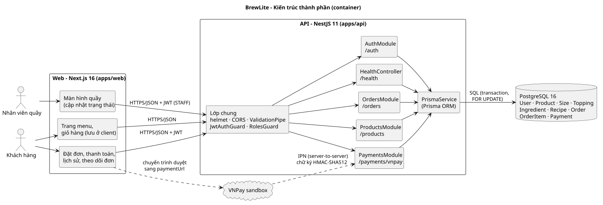
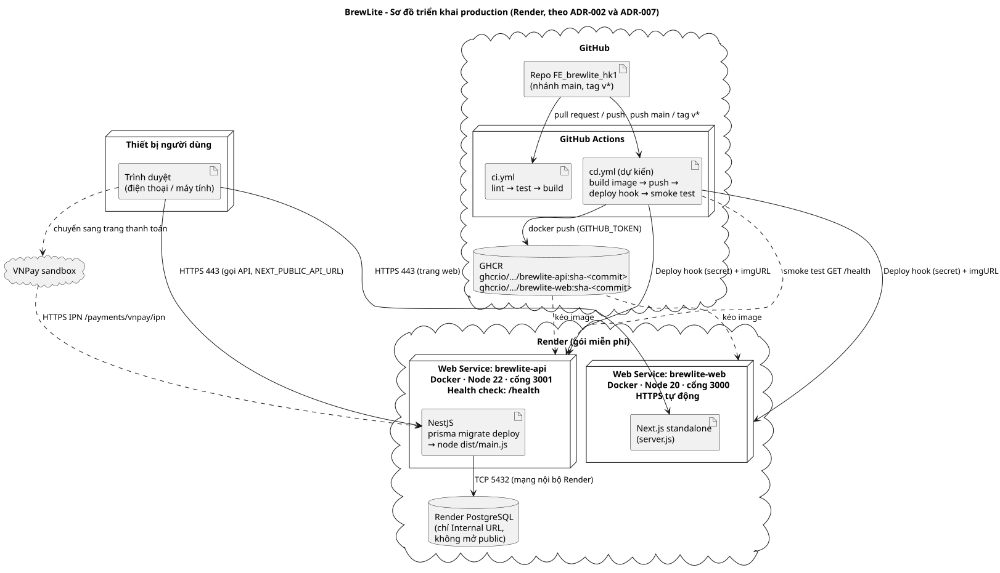
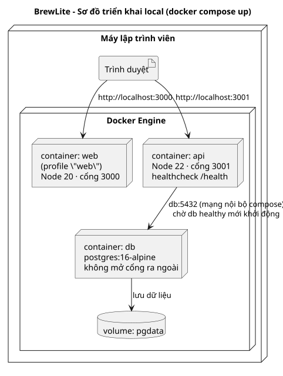

# Mô tả kiến trúc BrewLite

Tài liệu mô tả kiến trúc hệ thống đặt đồ uống BrewLite: các thành phần, cách chúng giao tiếp, cách
triển khai và các quyết định kiến trúc liên quan. Quyết định chi tiết nằm trong [ADR](adr/).

## 1. Tổng quan

| Hạng mục | Lựa chọn |
|---|---|
| Kiểu kiến trúc | Client–server 3 tầng: Web (trình bày) → API (nghiệp vụ) → PostgreSQL (dữ liệu) |
| Tổ chức mã nguồn | Monorepo: `apps/web`, `apps/api`, `docs/` |
| Backend | NestJS 11, modular monolith chia theo domain: auth, products, orders, payments |
| Truy cập dữ liệu | Prisma ORM 6, migration trong `apps/api/prisma/migrations` |
| Frontend | Next.js 16 (React 19), build dạng `standalone` để chạy trong Docker |
| Cơ sở dữ liệu | PostgreSQL 16 |
| Thanh toán | VNPay sandbox, xác thực chữ ký HMAC-SHA512 |
| Xác thực | JWT (Bearer), mật khẩu băm bằng bcrypt |
| Đóng gói, chạy | Docker image cho web và API; `docker compose` ở local; Render ở production (ADR-002) |
| CI/CD | GitHub Actions (ADR-007) |

## 2. Sơ đồ thành phần



Nguồn: [`architecture-container.puml`](../diagrams/architecture-container.puml)

### Web (`apps/web`)

- Hiển thị menu, chi tiết món (size, topping), giỏ hàng. Giỏ hàng lưu ở client, API không lưu giỏ.
- Gọi API qua địa chỉ `NEXT_PUBLIC_API_URL`. Biến này được gắn vào lúc build image, nên mỗi môi
  trường (local, production) cần build web với đúng URL API.
- Hiện trạng: trang menu đang dùng dữ liệu mẫu (`src/data/mock-products.ts`), chưa gọi API.

### API (`apps/api`)

| Module | Endpoint | Trách nhiệm |
|---|---|---|
| `AuthModule` | `POST /auth/register`, `POST /auth/login`, `GET /auth/me` | Đăng ký, đăng nhập, cấp JWT chứa `userId` và `role` |
| `ProductsModule` | `GET /products`, `GET /products/:id` | Menu, size, topping |
| `OrdersModule` | `POST /orders`, `GET /orders`, `GET /orders/me`, `GET /orders/:id`, `POST /orders/:id/cancel`, `PATCH /orders/:id/status` | Tạo đơn, trừ và hoàn kho, lịch sử, hủy đơn, nhân viên đổi trạng thái |
| `PaymentsModule` | `POST /payments/vnpay`, `GET /payments/vnpay/ipn`, `GET /payments/vnpay/return` | Tạo link VNPay, nhận và xác thực kết quả |
| `HealthController` | `GET /health` | Kiểm tra API và kết nối DB, dùng cho health check và smoke test |
| `PrismaService` | – | Kết nối DB dùng chung |

`/orders/me` và thanh toán lại có trong PR #16.

Lớp dùng chung cho mọi request (`setup-app.ts`, `common/current-user.ts`):

- `helmet`: thêm header bảo mật HTTP.
- CORS: chỉ cho phép các origin trong `CORS_ORIGIN`.
- `ValidationPipe` (`whitelist`, `forbidNonWhitelisted`): dữ liệu sai hoặc trường thừa trả 400.
- `JwtAuthGuard`: API cần đăng nhập trả 401 khi thiếu hoặc sai token.
- `RolesGuard` + `@Roles(STAFF)`: chặn khách gọi API của nhân viên (403).

### Cơ sở dữ liệu

Các bảng chính: `User`, `Product`, `Size`, `Topping`, `Ingredient`, `Recipe`, `Order`, `OrderItem`,
`Payment`. Chi tiết quan hệ xem [class diagram](../diagrams/class-domain.md).

## 3. Luồng chính

Chi tiết từng bước xem [sequence diagram](../diagrams/sequence-diagrams.md).

1. **Xem menu**: Web → `GET /products` → DB. Không cần đăng nhập.
2. **Đặt đơn**: Web → `POST /orders` (JWT). API tính giá từ DB, khóa nguyên liệu, trừ kho và tạo đơn
   `PENDING_PAYMENT` trong một transaction.
3. **Thanh toán**: Web → `POST /payments/vnpay` (JWT + `Idempotency-Key`) → nhận `paymentUrl` →
   trình duyệt sang VNPay. VNPay gọi IPN về API; trình duyệt quay về Web, Web gọi
   `/payments/vnpay/return` để lấy kết quả.
4. **Pha chế**: nhân viên đổi trạng thái `PAID → PREPARING → READY → COMPLETED`; khách xem trạng thái
   qua `GET /orders/:id`.

## 4. Vòng đời đơn hàng

```text
PENDING_PAYMENT ──thanh toán OK──▶ PAID ──▶ PREPARING ──▶ READY ──▶ COMPLETED
      │    ▲                        ▲
      │    └─thanh toán lại─┐       │
      │                     │       │
      ├─thanh toán lỗi──▶ PAYMENT_FAILED ──thanh toán OK──┘
      │                     │
      └──────hủy────────────┴──hủy──▶ CANCELLED (hoàn kho)
```

## 5. Thuộc tính chất lượng và cách kiến trúc đáp ứng

| Thuộc tính | Cách đáp ứng | NFR / ADR |
|---|---|---|
| Không bán vượt kho | Transaction + `SELECT ... FOR UPDATE` trên `Ingredient` theo thứ tự id (tránh deadlock) | NFR-15, ADR-006 |
| Không trừ tiền hai lần | `Idempotency-Key` duy nhất, khóa dòng `Order`, `UPDATE` có điều kiện khi nhận IPN | NFR-16, FR-26, ADR-005 |
| Bảo mật | JWT, bcrypt, `helmet`, CORS giới hạn, validate đầu vào, secret chỉ ở biến môi trường | NFR-04 → NFR-08, ADR-004 |
| DB không public | Production dùng Internal URL của Render; compose không mở cổng 5432 | NFR-10 |
| Tái tạo dữ liệu | Migration chạy khi API khởi động (`prisma migrate deploy`), seed khi DB trống | NFR-19, ADR-003 |
| Khả dụng | `GET /health` kiểm tra cả DB; Render dùng làm health check | NFR-17 |
| Triển khai | Docker image, CI chặn merge khi lỗi, CD theo ADR-007 | NFR-18, NFR-20 → NFR-22 |

## 6. Triển khai





Nguồn: [`deployment-production.puml`](../diagrams/deployment-production.puml),
[`deployment-local.puml`](../diagrams/deployment-local.puml). Hướng dẫn chạy và triển khai từng
bước xem [`docs/deployment.md`](../deployment.md).

| Node | Chạy gì | Ghi chú |
|---|---|---|
| Render Web Service `brewlite-web` | Image Next.js, cổng 3000 | HTTPS do Render cấp |
| Render Web Service `brewlite-api` | Image NestJS, cổng 3001 | Health check `/health`; chạy migration khi khởi động |
| Render PostgreSQL | PostgreSQL | Chỉ kết nối qua Internal URL |
| GitHub Actions + GHCR | CI, CD, kho image | Image tag theo commit SHA |
| VNPay sandbox | Cổng thanh toán | Gọi IPN về API qua HTTPS |

## 7. Giới hạn hiện tại

- Frontend chưa nối API (đang dùng dữ liệu mẫu).
- Chưa có pipeline CD (`cd.yml`); ADR-007 mới ở trạng thái đề xuất.
- Chưa tự hủy đơn quá hạn thanh toán (FR-22, Should).
- Chưa giới hạn số lần đăng nhập sai (NFR-09, Should) và chưa ghi log có cấu trúc (NFR-23, Should).
- `docker-compose.yml` chưa truyền biến `VNPAY_*` cho container API, nên thanh toán chỉ chạy khi
  chạy API trực tiếp với các biến này hoặc thêm chúng vào compose.
- Dịch vụ miễn phí của Render ngủ sau 15 phút không có request; lần gọi đầu mất khoảng 1 phút.

## 8. ADR liên quan

| ADR | Nội dung |
|---|---|
| [ADR-001](adr/001-monorepo.md) | Monorepo |
| [ADR-002](adr/002-deploy-platform.md) | Chọn Render làm nền tảng triển khai |
| [ADR-003](adr/003-postgresql-prisma-migrations.md) | PostgreSQL + Prisma migration |
| [ADR-004](adr/004-jwt-authentication.md) | Xác thực JWT |
| [ADR-005](adr/005-payment-gateway-idempotency.md) | Cổng thanh toán và idempotency |
| [ADR-006](adr/006-inventory-transaction-row-locking.md) | Transaction và khóa dòng cho tồn kho |
| [ADR-007](adr/007-ci-cd-github-actions.md) | CI/CD bằng GitHub Actions |

ADR-001, 003 → 007 nằm trong PR #14.
