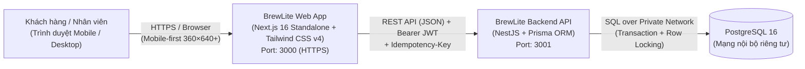

# Mô tả Kiến trúc Frontend – BrewLite (Next.js Web App)

> **Task 3.1** · **Người thực hiện:** Trần Minh Trí (3124410371)  
> **Thư mục mã nguồn:** [`apps/web`](../../apps/web) · **Cấu hình:** [`next.config.ts`](../../apps/web/next.config.ts), [`Dockerfile`](../../apps/web/Dockerfile)  
> **Liên quan:** NFR-02, NFR-06, NFR-07, NFR-11, NFR-13, NFR-14, NFR-18, [`ADR-001`](adr/001-monorepo.md), [`ADR-002`](adr/002-deploy-platform.md), [`ADR-004`](adr/004-jwt-authentication.md), [`ADR-007`](adr/007-ci-cd-github-actions.md), [`ADR-008`](adr/008-simulated-wallet-card-payment.md).

---

## 1. Vị trí của Frontend trong kiến trúc tổng thể (C4 Container)

Ứng dụng Frontend (`apps/web`) đóng vai trò là **tầng trình diễn (Presentation Layer)** duy nhất tiếp xúc trực tiếp với người dùng cuối (Khách hàng và Nhân viên quầy) thông qua trình duyệt web chuẩn HTTPS trên thiết bị di động và máy tính.

- **Quy chuẩn triển khai (`ADR-002`):** Frontend được đóng gói thành Docker image riêng từ [`apps/web/Dockerfile`](../../apps/web/Dockerfile) (3 giai đoạn: `deps` → `build` → `runtime`) với chế độ `output: "standalone"` và triển khai thành Web Service trên nền tảng **Render** với giao thức **HTTPS** mặc định (`NFR-07`).
- **Phạm vi sản phẩm (`scope-assumptions-risks.md`):** Hệ thống phát triển theo hướng **Mobile-first Responsive Web** (tối ưu từ kích thước `360×640` px trở lên theo `NFR-11`). Ứng dụng mobile native và PWA offline hoàn toàn được loại khỏi phạm vi MVP theo xác nhận của giảng viên để tập trung chất lượng luồng nghiệp vụ chính.

---

## 2. Kiến trúc phân lớp nội bộ (`apps/web/src/`)

Mã nguồn Frontend áp dụng **Kiến trúc phân lớp kết hợp theo tính năng (Layered Feature-oriented Architecture)** trên nền tảng **Next.js 16 App Router**:

| Tầng (Layer) | Thư mục / Tệp tiêu biểu | Trách nhiệm chính |
|--------------|------------------------|-------------------|
| **1. Định tuyến & Khung trang (Routing & Layout)** | `src/app/layout.tsx`, `src/app/page.tsx`, `src/app/globals.css` | Thiết lập khung giao diện toàn cục, font chữ (Geist), quản lý đường dẫn theo chuẩn App Router và điều phối luồng trang (`/`, đăng nhập, checkout, lịch sử đơn). |
| **2. Thành phần giao diện (UI Components)** | `Header.tsx`, `MenuFilter.tsx`, `ProductCard.tsx`, `ProductDetailModal.tsx`, `CartDrawer.tsx` | Tách biệt từng thành phần tái sử dụng cao, thiết kế mobile-first với vùng chạm tối thiểu 44×44 px (`NFR-11`), định dạng tiền Việt Nam `45.000 ₫` (`NFR-13`) và ngôn ngữ giao diện tiếng Việt nhất quán. |
| **3. Trạng thái & Lưu trữ cục bộ (Client State & Storage)** | `src/utils/cart.ts` | Quản lý giỏ hàng trên `localStorage` (`brewlite_cart`), hỗ trợ gộp món trùng cấu hình size/topping/ghi chú (`FR-10`), cập nhật tức thời qua `CustomEvent("brewlite_cart_updated")` và hook chuẩn React 19 `useSyncExternalStore`. |
| **4. Kiểu dữ liệu miền (Domain Types)** | `src/types/product.ts` | Định nghĩa chặt chẽ bằng TypeScript các interface `Product`, `ProductSize`, `Topping`, `CartItem` khớp với hợp đồng API từ NestJS. |
| **5. Giao tiếp API & Bảo mật (API Client & Security)** | Gọi REST API qua biến `NEXT_PUBLIC_API_URL` | Đính kèm `Authorization: Bearer <JWT>` cho các route cần đăng nhập (`ADR-004`), tự sinh `Idempotency-Key` (`crypto.randomUUID()`) khi gửi yêu cầu thanh toán (`ADR-008`), và **chỉ gửi ID lựa chọn** (tuyệt đối không dùng giá tính từ client làm nguồn chân lý theo `FR-21`). |
| **6. Kiểm thử & Chất lượng mã (Testing & Lint)** | `vitest.config.mts`, `src/test/setup.ts`, `*.spec.tsx` | Đảm bảo chất lượng qua ESLint 9 (`eslint-config-next` tuân thủ nghiêm luật React 19 Hooks) và kiểm thử tự động thành phần bằng **Vitest 5 + React Testing Library + jsdom**. |

---

## 3. Lý do lựa chọn công nghệ & kiến trúc

| Thành phần lựa chọn | Lý do lựa chọn gắn với yêu cầu dự án |
|---------------------|--------------------------------------|
| **Next.js 16 (App Router) + React 19** | Công nghệ bắt buộc của đề bài; App Router hỗ trợ chia nhỏ route rõ ràng, tối ưu bundle code-splitting cho màn hình di động (`NFR-02`) và dễ dàng tích hợp SSR/Client Components linh hoạt. |
| **Chế độ đóng gói `output: "standalone"`** | Giúp Docker image ở giai đoạn `runtime` chỉ sao chép phần tối thiểu cần thiết để chạy `node server.js`, giảm mạnh dung lượng image và tăng tốc độ deploy/khởi động trên Render (`NFR-18`, `NFR-21`). |
| **Tailwind CSS v4 (Turbopack)** | Thiết kế giao diện nhanh theo chuẩn **mobile-first** (`sm:`, `md:`, `lg:`), đảm bảo không phát sinh cuộn ngang ở màn hình 360×640 (`NFR-11`), không phải duy trì hàng loạt tệp CSS thủ công rườm rà. |
| **Client Cart via `localStorage` + `useSyncExternalStore`** | Cho phép **khách vãng lai (chưa đăng nhập)** xem menu và thêm vào giỏ hàng mượt mà ngay lập tức (`SRS mục 2.1`, `FR-10`), đồng thời giữ nguyên giỏ hàng khi bị chuyển hướng qua trang Đăng nhập (`FR-18`). Sử dụng `useSyncExternalStore` thay cho `setState` trong `useEffect` giúp triệt tiêu hoàn toàn lỗi hydration mismatch và tuân thủ quy tắc lint khắt khe của React 19. |
| **Vitest 5 + Testing Library** | Nhẹ, tốc độ chạy nhanh gấp nhiều lần Jest trên dự án TypeScript/ESM hiện đại, tích hợp trực tiếp vào pipeline CI `npm run lint && npm test && npm run build` (`NFR-20`). |

---

## 4. Phân tích Ưu điểm, Hạn chế và Trade-off (Sự đánh đổi kiến trúc)

| Khía cạnh đánh đổi | Ưu điểm đạt được | Hạn chế chấp nhận | Lý do chấp nhận Trade-off |
|--------------------|-------------------|-------------------|--------------------------|
| **1. Lưu giỏ hàng ở `localStorage` + `useSyncExternalStore` *(thay vì lưu DB hoặc dùng Redux/Zustand)*** | - Phản hồi 0 ms, không tốn request API khi khách thêm/bớt món. - Khách vãng lai dùng được ngay không cần tạo session DB. - Không tăng dung lượng bundle bằng thư viện quản lý state ngoài. | - Không tự động đồng bộ giỏ hàng giữa hai thiết bị khác nhau của cùng một người dùng. - Trạng thái giỏ hàng chỉ mang tính tạm tính; nếu tồn kho thực tế vừa thay đổi thì lúc đặt đơn mới phát hiện ở backend. | Phù hợp hoàn toàn với kịch bản MVP mua đồ uống tại quầy trong 1 phiên truy cập (SRS mục 2.1) và tiết kiệm tài nguyên cho gói miễn phí của Render. |
| **2. Chạy Next.js `standalone` trong Docker trên Render *(thay vì Vercel Serverless)*** | - Gom toàn bộ Web, API và DB chạy đồng nhất qua `docker compose up` ở local (`NFR-18`). - Chung một luồng CI/CD build Docker image theo commit SHA trên GitHub Actions (`ADR-007`). | - Dịch vụ miễn phí trên Render bị ngủ (cold start ~30–60 giây) nếu không có truy cập trong 15 phút (`ADR-002`). | Đáp ứng quy chuẩn Docker hóa bắt buộc của môn học (`NFR-18`, `NFR-21`), miễn phí 100% và dễ kiểm soát cấu hình trên cùng một nền tảng. |
| **3. Mobile-first Responsive Web *(thay vì Native App hoặc PWA Service Worker phức tạp)*** | - Triển khai tức thì trên mọi thiết bị qua trình duyệt Chrome/Safari (`NFR-14`). - Không gặp rắc rối về cache cũ (stale cache) của Service Worker khiến khách thấy nhầm món còn hàng trong khi kho đã hết. | - Không sử dụng được khi thiết bị mất kết nối Internet hoàn toàn. | Đã được giảng viên xác nhận loại ứng dụng mobile/PWA ra khỏi phạm vi (`scope-assumptions-risks.md`), giúp nhóm tập trung hoàn thiện luồng nghiệp vụ cốt lõi trong 2 ngày. |
| **4. Truyền cấu hình API lúc build (`ARG NEXT_PUBLIC_API_URL`) *(thay vì server-side runtime proxy)*** | - Cấu trúc đơn giản, frontend gọi trực tiếp endpoint của backend qua CORS đã khóa chặt origin (`NFR-07`). | - Nếu thay đổi domain của backend API, cần build lại image Docker của frontend với giá trị `NEXT_PUBLIC_API_URL` mới. | Phù hợp với mô hình CD tự động build và deploy lại container theo mỗi lần push/release (`ADR-007`). |
| **5. Tính tạm tiền trên Client, tính chốt lại ở Server (`FR-21`)** | - Giao diện modal chọn size/topping cập nhật tổng tiền tức thời ngay khi bấm mà không phải chờ gọi API tính giá. | - Phải duy trì logic tính cộng phụ thu ở cả Frontend (để hiển thị) và Backend (để chốt đơn). | Đảm bảo đồng thời hai mục tiêu: trải nghiệm người dùng mượt mà và **bảo mật tuyệt đối chống gian lận giá** từ phía trình duyệt. |

