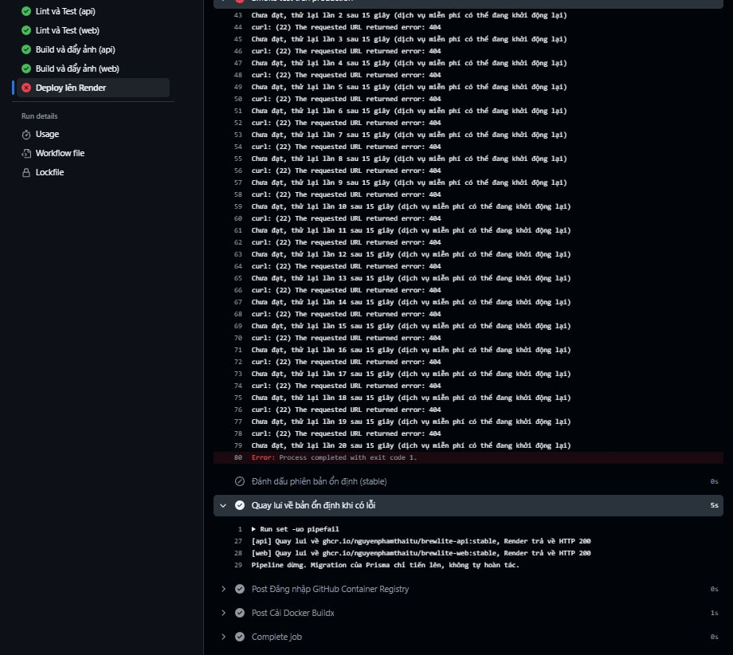
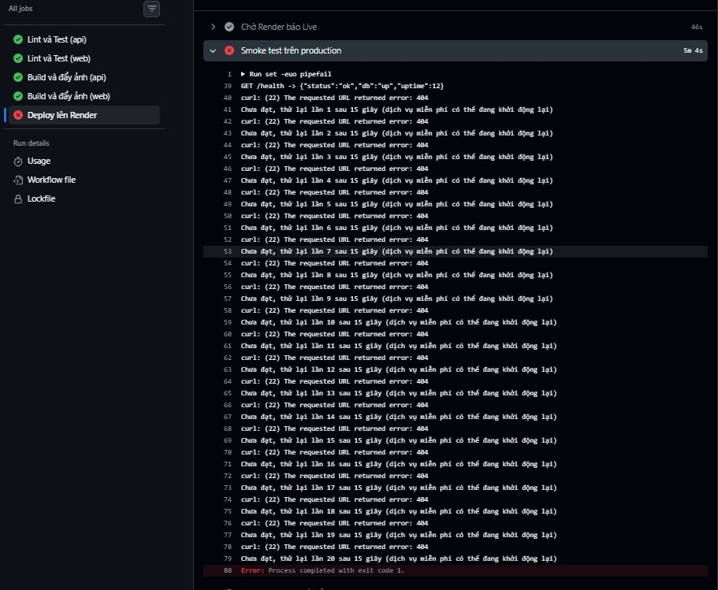

# Hướng dẫn triển khai (Task 5)

Tài liệu mô tả cách BrewLite được build, triển khai, kiểm tra và quay lui. Mọi thông tin bám theo
[`.github/workflows/cd.yml`](../.github/workflows/cd.yml), [`docker-compose.yml`](../docker-compose.yml)
và hai Dockerfile trong `apps/api`, `apps/web`. Tài liệu chỉ ghi **tên** biến và secret, không ghi giá trị.

## 1. Kiến trúc production

| Thành phần | Nền tảng | Ghi chú |
|---|---|---|
| Web (Next.js) | Render Web Service `brewlite-web-image`, vùng Singapore | Chạy từ ảnh GHCR `brewlite-web` |
| API (NestJS) | Render Web Service `brewlite-api-image`, vùng Singapore | Chạy từ ảnh GHCR `brewlite-api` |
| Cơ sở dữ liệu | Render Managed PostgreSQL `brewlite-db` | Chỉ nhận kết nối nội bộ, xem mục 8 |
| Registry | GitHub Container Registry (`ghcr.io`) | Pipeline đăng nhập bằng `GITHUB_TOKEN` |

Sơ đồ chi tiết ba ranh giới (local, CI, production): [`diagrams/deployment.md`](diagrams/deployment.md).

## 2. Địa chỉ production

| Mục | Địa chỉ |
|---|---|
| Web (HTTPS) | https://brewlite-web-image.onrender.com |
| API | https://brewlite-api-image.onrender.com |
| Health check | https://brewlite-api-image.onrender.com/health |

Dịch vụ gói miễn phí có thể ngủ khi không có truy cập, lần gọi đầu có thể chậm.
Gói Render đang dùng: Free cho web, API và cơ sở dữ liệu (kiểm tra ngày 15/11/2026).

## 3. Pipeline CD (`cd.yml`)

Kích hoạt khi push vào `main`, push tag `v*`, hoặc chạy tay (`workflow_dispatch`).

| Job | Việc làm |
|---|---|
| `quality` (api, web) | Install, Lint, Unit Test, Build |
| `build-push` (api, web) | Build ảnh Docker (`linux/amd64`), đẩy lên GHCR |
| `deploy` | Gửi deploy hook, chờ Render báo Live, smoke test, đánh dấu `stable`, quay lui khi lỗi |

Job `deploy` chỉ chạy khi biến `CD_DEPLOY_ENABLED` bằng `true`. Hai job đầu luôn chạy.
Giá trị hiện tại của biến: `true` (kiểm tra ngày 15/11/2026).

Tag ảnh được đẩy:

| Tag | Khi nào |
|---|---|
| `sha-<7 ký tự commit>` | Mọi lần chạy |
| `latest` | Mọi lần chạy |
| `vX.Y.Z` | Khi chạy từ tag phiên bản |
| `stable` | Chỉ gắn sau khi smoke test đạt |

## 4. Migration cơ sở dữ liệu

Ảnh API khởi động bằng `npm run start:prod`. Script này trong `apps/api/package.json` là
`prisma migrate deploy && node dist/main.js`: chạy migration chưa áp dụng rồi mới khởi động API.

Local và production tái tạo được cơ sở dữ liệu từ thư mục `apps/api/prisma` (migration và seed).
Biến `AUTO_SEED` quyết định có nạp dữ liệu mẫu khi khởi động hay không.

## 5. Smoke test

Chạy ngay sau khi Render báo Live, mỗi kiểm tra thử lại tối đa 20 lần, cách nhau 15 giây:

1. `GET /health` của API phải trả `status` là `ok` và `db` là `up`.
2. `GET /products` của API phải trả nội dung không rỗng.
3. `GET /` của web phải trả HTTP thành công.

Nếu một bước lỗi, pipeline dừng và chạy quay lui (mục 7).

## 6. Secret và biến cấu hình

Chỉ liệt kê tên. Không đưa giá trị vào repo, tài liệu hay log.

**GitHub, Settings, Secrets and variables, Actions**

| Loại | Tên | Công dụng |
|---|---|---|
| Secret | `RENDER_API_DEPLOY_HOOK` | Deploy hook của dịch vụ API |
| Secret | `RENDER_WEB_DEPLOY_HOOK` | Deploy hook của dịch vụ web |
| Secret | `RENDER_API_KEY` | Hỏi trạng thái deploy qua Render API |
| Variable | `NEXT_PUBLIC_API_URL` | Địa chỉ API, nhúng vào ảnh web lúc build, dùng cho smoke test |
| Variable | `PRODUCTION_WEB_URL` | Địa chỉ web cho smoke test |
| Variable | `CD_DEPLOY_ENABLED` | `true` thì mới chạy job deploy |

`GITHUB_TOKEN` do GitHub cấp tự động (quyền `packages: write` để đẩy ảnh).

**Render, dịch vụ `brewlite-api-image`, Environment**

`DATABASE_URL`, `JWT_SECRET`, `STAFF_PASSWORD`, `CORS_ORIGIN`, `AUTO_SEED`, `NODE_ENV`.
`DATABASE_URL` dùng địa chỉ nội bộ (Internal Database URL) của `brewlite-db`.

Lưu ý: `NEXT_PUBLIC_API_URL` được nhúng lúc build, nên đổi địa chỉ API thì phải build lại ảnh web.

## 7. Phát hành và quay lui

### 7.1 Phát hành

1. Merge PR vào `main`. Pipeline tự chạy.
2. Muốn gắn phiên bản: tạo tag, ví dụ:
   ```bash
   git tag v0.1.0
   git push origin v0.1.0
   ```
3. Theo dõi tại tab **Actions** của repository. Thành công khi cả ba job xanh.

Release và release notes do Anh Vũ phụ trách, xem trang Releases của repository.

### 7.2 Quay lui tự động

Khi bước gửi deploy, chờ Live hoặc smoke test lỗi, pipeline gửi lại deploy hook với ảnh `:stable`
cho cả API và web. Điều kiện: đã từng có một lần deploy thành công để gắn `stable`.
Lần deploy đầu tiên chưa có `stable` thì pipeline chỉ dừng, không quay lui được.

### 7.3 Quay lui thủ công

Chạy lại workflow CD từ một commit hoặc tag cũ đã ổn định (tab Actions, chọn workflow CD, Run workflow).

### 7.4 Giới hạn của quay lui

Quay lui chỉ đưa **ảnh Docker** về bản cũ. Migration của Prisma chỉ đi tiến, không tự hoàn tác.
Nếu một migration đã áp dụng làm đổi cấu trúc dữ liệu, cần xử lý riêng (migration sửa lỗi hoặc khôi phục
dữ liệu), xem mục 9.

Kết quả thử quay lui thực tế (15/11/2026): lần chạy CD #5 (chạy tay) cố ý làm sai để thử nhánh lỗi. Smoke test thất bại, pipeline bỏ qua bước đánh dấu `stable` và chạy bước quay lui, Render nhận lệnh quay lui cả API và web về ảnh `stable` (HTTP 200). Lần chạy CD #6 (chạy tay) sau đó thành công.





## 8. Bảo mật production

- **HTTPS:** web và API được Render phục vụ qua HTTPS (cổng 443).
- **Cơ sở dữ liệu không public:** khung PostgreSQL Inbound IP Rules của `brewlite-db` để trống,
  Render báo toàn bộ truy cập từ internet bị chặn. API kết nối qua địa chỉ nội bộ.
  Bằng chứng: [`diagrams/db-inbound-rules-empty.png`](diagrams/db-inbound-rules-empty.png).
  Xác nhận sau thay đổi: ngày 15/11/2026, `GET /health` trả `{"status":"ok","db":"up"}`, API vẫn kết nối được cơ sở dữ liệu.
- **Secret:** lưu trong GitHub Secrets và Render Environment, không có trong repo.
  GitHub che giá trị secret trong log Actions.

## 9. Sao lưu và khôi phục

Cơ sở dữ liệu `brewlite-db` đang dùng gói Free. Theo trang Recovery trên Render (kiểm tra ngày 15/11/2026),
Point-in-Time Recovery và Export không dùng được ở gói này, cần nâng lên gói trả phí. Hiện **không có sao lưu
tự động** do Render cung cấp. Nếu mất dữ liệu, cấu trúc bảng và dữ liệu mẫu tạo lại được bằng migration và seed
(mục 4), còn dữ liệu phát sinh khi chạy (tài khoản, đơn hàng) sẽ không khôi phục được.

**Hạn dùng của cơ sở dữ liệu:** theo trang Info của `brewlite-db` trên Render (kiểm tra ngày 15/11/2026),
cơ sở dữ liệu gói Free hết hạn ngày **10/12/2026** và sẽ bị xóa nếu không nâng lên gói trả phí.
Dự án dự kiến được chấm trước ngày này nên chưa nâng gói. Sau ngày hết hạn, API sẽ không còn kết nối
được cơ sở dữ liệu và `/health` sẽ báo lỗi, đây là hành vi đã biết, không phải lỗi pipeline.
## 10. Log và theo dõi

- Log runtime của web, API và cơ sở dữ liệu xem trên Render Dashboard, mục Logs của từng dịch vụ.
- Log pipeline xem trong tab Actions của GitHub.
- Health check: `GET /health` của API.

## 11. Chạy local, kiểm thử, build

Chạy toàn bộ bằng Docker Compose (web, API, PostgreSQL):

```bash
cp .env.example .env
docker compose up --build
```

| Dịch vụ | Địa chỉ local |
|---|---|
| Web | http://localhost:3000 |
| API | http://localhost:3001 |
| Health | http://localhost:3001/health |

Cổng 5432 của PostgreSQL không mở ra ngoài, chỉ API truy cập qua mạng nội bộ của Compose.

Kiểm thử, lint, build (chạy trong thư mục `apps/api` hoặc `apps/web`, không chạy ở thư mục gốc):

```bash
npm ci
npm run lint
npm test
npm run build
```

Tệp `.env.example` do Tuấn Vỹ phụ trách. Đặt mật khẩu và `JWT_SECRET` riêng, không dùng chuỗi mẫu cho production.