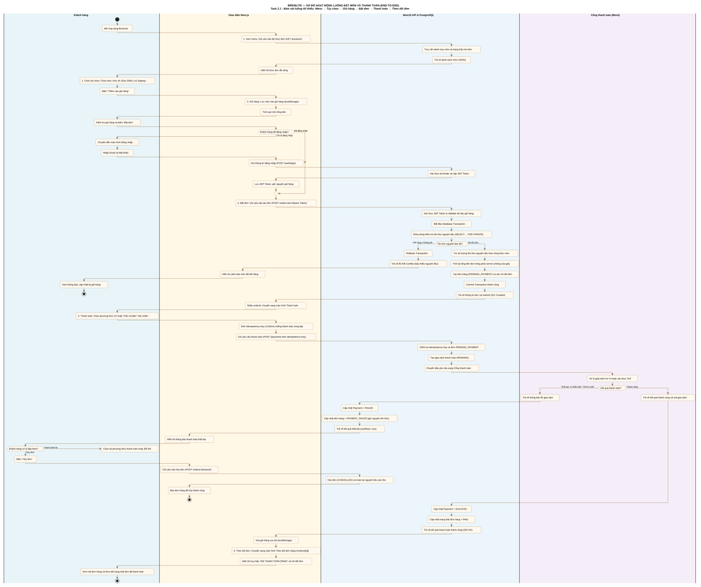

# Activity diagram – Luồng đặt món và thanh toán (BrewLite)

> Task 2.1 · Người thực hiện: Trần Minh Trí (3124410371) · Reviewer: Quách Văn Trường  
> Nguồn: [`activity-order-flow.puml`](activity-order-flow.puml) · Kết xuất: [`activity-order-flow.svg`](activity-order-flow.svg)  
> Căn cứ đề bài: Mục 1.1 (Luồng tối thiểu) & Mục 4.1 (Yêu cầu Activity diagram).

---

## 1. Bám sát luồng nghiệp vụ tối thiểu của Đề bài (Mục 1.1)

Sơ đồ thể hiện trực quan và chuẩn xác chuỗi 6 bước nghiệp vụ tối thiểu được quy định trong đề bài:
$$\text{Xem menu} \longrightarrow \text{Chọn tùy chọn} \longrightarrow \text{Giỏ hàng} \longrightarrow \text{Đặt đơn} \longrightarrow \text{Thanh toán} \longrightarrow \text{Theo dõi đơn}$$

Các phân làn trách nhiệm (Swimlanes):
- **Khách hàng (`Customer`):** Tác nhân người dùng thao tác duyệt menu, chọn size/topping, đặt đơn, chọn cách thanh toán và theo dõi tiến trình đơn.
- **Giao diện Next.js (`Frontend`):** Quản lý trạng thái giỏ hàng (`localStorage`), chuyển hướng đăng nhập bảo toàn giỏ hàng, sinh `Idempotency-Key` (UUIDv4), gửi request API và hiển thị kết quả.
- **NestJS API & Database (`Backend`):** Xác thực JWT, validate DTO, tính lại tổng tiền server, quản lý transaction với khóa dòng bi quan (`SELECT ... FOR UPDATE`), trừ kho và quản lý trạng thái đơn hàng.
- **Cổng thanh toán (`PaymentGateway`):** Giả lập trừ số dư Ví (`WALLET`) hoặc xác thực Thẻ (`CARD`), trả kết quả thành công/thất bại có kiểm soát.

---

## 2. Xử lý 3 nhánh ngoại lệ bắt buộc (Mục 4.1)

1. **Nhánh Chưa đăng nhập:** Khi khách bấm đặt đơn mà chưa có token, chuyển hướng sang màn hình Đăng nhập (`POST /auth/login`), cấp JWT và **bảo toàn nguyên vẹn giỏ hàng** để tiếp tục đặt hàng.
2. **Nhánh Hết hàng / Thiếu nguyên liệu:** Backend khóa dòng kiểm tra kho, nếu không đủ thì **Rollback Transaction**, trả mã lỗi `409 Conflict` (FR-20) để giao diện báo cho khách cập nhật lại giỏ hàng.
3. **Nhánh Thanh toán thất bại:** Khi Ví thiếu tiền hoặc Thẻ bị từ chối, đơn chuyển sang trạng thái **`PAYMENT_FAILED`** (FR-27), **giữ nguyên tồn kho nguyên liệu**; khách có thể bấm *"Thanh toán lại"* hoặc *"Hủy đơn để hoàn kho"*.

---

## 3. Bảng đối chiếu tiêu chí nghiệm thu Task 2.1

| Tiêu chí đề bài yêu cầu (Mục 4.1) | Thể hiện trên sơ đồ | Căn cứ trong dự án |
|-----------------------------------|---------------------|-------------------|
| **Điểm bắt đầu & kết thúc** | Có `start` (Mở ứng dụng) và `stop` (Theo dõi đơn sau thanh toán / Hủy đơn). | Mục 4.1 & Mục 1.1 |
| **Hành động người dùng & hệ thống** | Phân định rạch ròi qua 4 phân làn (`Customer`, `Frontend`, `Backend`, `PaymentGateway`). | Bảng stakeholder |
| **Decision / Merge rẽ nhánh** | Cấu trúc `if (...) then (...) else (...) endif` chuẩn UML cho cả 3 điểm rẽ nhánh. | PlantUML Activity |
| **Swimlane đa thành phần** | 4 phân làn trọng tâm, tập trung luồng mua sắm của khách. | Mục 4.1 |
| **Nhánh chưa đăng nhập** | Rẽ nhánh 1: Chuyển hướng đăng nhập, cấp JWT và bảo toàn giỏ hàng. | FR-18 |
| **Nhánh hết hàng** | Rẽ nhánh 2: Kiểm tra kho khóa dòng, Rollback và trả mã lỗi 409 Conflict. | FR-19, FR-20, ADR-006 |
| **Nhánh thanh toán thất bại** | Rẽ nhánh 3: Chuyển `PAYMENT_FAILED`, giữ kho, cho phép thanh toán lại hoặc hủy đơn hoàn kho. | FR-27, ADR-008 |
