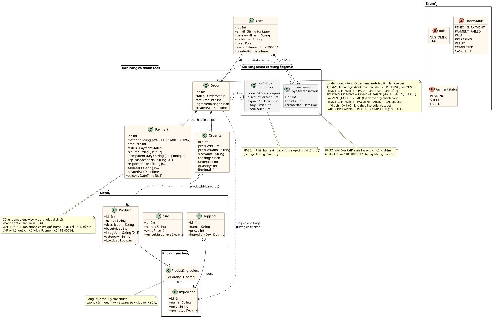

# Class diagram mức domain – BrewLite

> Task 2.3 · Người thực hiện: Quách Văn Trường · Reviewer: Trần Minh Trí
> Nguồn: [`class-domain.puml`](class-domain.puml) · Kết xuất: [`class-domain.svg`](class-domain.svg)
> Bám theo mô hình dữ liệu [`apps/api/prisma/schema.prisma`](../../apps/api/prisma/schema.prisma) (gồm thay đổi ở PR #16)
> và mã yêu cầu trong [`srs.md`](../requirements/srs.md) (PR #15)

## 1. Các lớp

| Lớp | Vai trò | Yêu cầu / use-case |
|-----|---------|--------------------|
| `User` | Tài khoản khách hàng hoặc nhân viên; mật khẩu lưu dạng băm; `walletBalance` là số dư ví mô phỏng. | FR-14, FR-15, FR-17, FR-24, UC-05, UC-06 |
| `Product` | Đồ uống trên menu: giá gốc, mô tả, ảnh, danh mục, còn bán hay không. | FR-01, FR-04, FR-06, UC-02, UC-03 |
| `Size` | Size S/M/L: phụ thu và hệ số nhân công thức (S = 1; M = 1,25; L = 1,5). | FR-07, UC-03 |
| `Topping` | Topping có giá và lượng nguyên liệu dùng cho một phần. | FR-08, UC-03 |
| `Ingredient` | Nguyên liệu trong kho, `quantity` là lượng còn lại. | FR-03, FR-20, UC-01 |
| `ProductIngredient` | Công thức: một ly size chuẩn cần bao nhiêu nguyên liệu. | FR-20 |
| `Order` | Đơn hàng: trạng thái, tổng tiền tính ở server, lượng nguyên liệu đã trừ để hoàn kho khi hủy. | FR-19, FR-20, FR-27, FR-30, FR-31, FR-34, UC-01, UC-07 → UC-09, UC-11 |
| `OrderItem` | Một dòng trong đơn; lưu bản chụp tên món, size, topping, đơn giá tại thời điểm đặt. | FR-19, FR-21, UC-01 |
| `Payment` | Một giao dịch thanh toán: Ví/Thẻ mô phỏng hoặc VNPay sandbox; `idempotencyKey` chống trùng; thẻ chỉ lưu 4 số cuối. | FR-24 → FR-27, UC-01 |
| `OrderStatusHistory` | Một lần đổi trạng thái đơn: từ trạng thái nào sang trạng thái nào, lý do, thời điểm và người thực hiện. | FR-22, FR-34, UC-08, UC-11 |
| `Promotion` *(mở rộng)* | Mã giảm giá: mã, phần trăm giảm, hạn dùng, giới hạn và số lượt đã dùng. | FR-36, UC-10 |
| `LoyaltyTransaction` *(mở rộng)* | Một lần cộng điểm thưởng khi đơn chuyển `PAID`. | FR-37 |

`Promotion` và `LoyaltyTransaction` là hai lớp đề bài bắt buộc có trong class diagram. Theo
[`scope-assumptions-risks.md`](../requirements/scope-assumptions-risks.md), đây là phạm vi mở rộng
(SRS xếp FR-36, FR-37 mức Could) nên **chưa có trong `schema.prisma`**. Trên sơ đồ, hai lớp này tô xám,
gắn nhãn `<<mở rộng>>`, quan hệ vẽ nét đứt. Thuộc tính lấy từ tiêu chí chấp nhận của FR-36, FR-37.

## 2. Quan hệ và multiplicity

| Quan hệ | Multiplicity | Giải thích |
|---------|--------------|------------|
| User – Order | 1 – 0..* | Mỗi đơn thuộc đúng một khách (`Order.userId`). |
| Order ◆ OrderItem | 1 – 1..* (composition) | Đơn có ít nhất 1 món (DTO chặn giỏ rỗng); xóa đơn thì xóa dòng (`onDelete: Cascade`). |
| OrderItem ⇢ Product | 0..* – 1 | Chỉ lưu `productId` kèm bản chụp tên và giá, **không có khóa ngoại**, để đơn cũ giữ nguyên khi menu thay đổi. |
| Order ◆ Payment | 1 – 0..* | Mỗi lần bấm thanh toán (một `Idempotency-Key`) là một `Payment`; thanh toán lại sau lỗi tạo `Payment` mới. |
| Order ◆ OrderStatusHistory | 1 – 1..* (composition) | Dòng đầu tiên ghi lúc tạo đơn (`fromStatus` trống); mỗi lần đổi trạng thái thêm một dòng. |
| OrderStatusHistory → User | 0..* – 0..1 | Người đổi trạng thái (`changedById`); trống khi hệ thống tự đổi (IPN VNPay, tự hủy đơn quá hạn). |
| Product – ProductIngredient – Ingredient | 1 – 0..* – 1 | Bảng công thức, khóa chính `(productId, ingredientId)`. |
| Topping → Ingredient | 0..* – 1 | Mỗi topping tiêu hao một loại nguyên liệu. |
| Order ⇢ Ingredient | phụ thuộc | `ingredientUsage` lưu `{ ingredientId: lượng đã trừ }` để hoàn kho. |
| Order ⇢ Promotion *(mở rộng)* | 0..* – 0..1 | Mỗi đơn áp tối đa một mã. |
| User ◆ LoyaltyTransaction *(mở rộng)* | 1 – 0..* | Điểm hiện có bằng tổng `points`. |
| LoyaltyTransaction ⇢ Order *(mở rộng)* | 0..1 – 1 | Mỗi đơn `PAID` sinh tối đa một giao dịch cộng điểm; đơn bị hủy không sinh điểm (FR-37). |

`Size` không có quan hệ khóa ngoại tới `OrderItem`: đơn lưu `sizeName` dạng bản chụp.

## 3. Enum trạng thái

| Enum | Giá trị | Ghi chú |
|------|---------|---------|
| `OrderStatus` | `PENDING_PAYMENT`, `PAYMENT_FAILED`, `PAID`, `PREPARING`, `READY`, `COMPLETED`, `CANCELLED` | `COMPLETED`, `CANCELLED` là trạng thái kết thúc. |
| `PaymentStatus` | `PENDING`, `SUCCESS`, `FAILED` | Ví/Thẻ mô phỏng có kết quả ngay; VNPay đi qua `PENDING` rồi mới có kết quả. |
| `Role` | `CUSTOMER`, `STAFF` | `STAFF` xem mọi đơn và đẩy trạng thái pha chế. |
| `Payment.method` | `WALLET`, `CARD`, `VNPAY` | Lưu dạng chuỗi trong DB. |

Chuyển trạng thái đơn trong code:
- `PENDING_PAYMENT → PAID`, `PAYMENT_FAILED → PAID`: thanh toán thành công (`mock-payments.service.ts`, `payments.service.ts`).
- `PENDING_PAYMENT → PAYMENT_FAILED`: thanh toán lỗi, giữ kho để khách thanh toán lại (FR-27).
- `PENDING_PAYMENT | PAYMENT_FAILED → CANCELLED`: khách hủy, hoặc hệ thống tự hủy khi quá hạn thanh toán (mặc định 15 phút, FR-22); hoàn kho theo `ingredientUsage` (`OrdersService.cancelPending`).
- `PAID → PREPARING → READY → COMPLETED`: chỉ `STAFF`, đúng thứ tự (`NEXT_STATUS` trong `orders.dto.ts`, FR-34).

Mọi lần chuyển ở trên đều đi qua `changeOrderStatus` (`orders/order-status.ts`): khóa dòng `Order`, kiểm tra
trạng thái hiện tại, đổi trạng thái và ghi một dòng `OrderStatusHistory` trong cùng transaction (FR-34).

## 4. Đối chiếu với SRS

Sau khi SRS được chốt (PR #15) và code cập nhật ở PR #16, các điểm lệch trước đây (trạng thái
`PENDING_PAYMENT`/`PAYMENT_FAILED`, thanh toán Ví/Thẻ mô phỏng, `Idempotency-Key`, `GET /orders/me`)
đã khớp. `GET /staff/orders` (FR-33), lịch sử trạng thái (FR-34) và tự hủy đơn quá hạn (FR-22) cũng đã có
trong code. Còn lại:

| Điểm | SRS | Code và sơ đồ này |
|------|-----|-------------------|
| Vai trò | `CUSTOMER`, `STAFF`, `ADMIN` (FR-17) | `CUSTOMER`, `STAFF`; `ADMIN` chỉ cần khi làm FR-35, FR-38 (Should/Could) |
| Tồn kho | "tồn kho" theo sản phẩm (FR-03, FR-20) | Theo nguyên liệu × công thức × hệ số size (ADR-006) |
| Cổng thanh toán thật | Ngoài phạm vi (FR-39) | Có thêm VNPay sandbox, không bắt buộc cấu hình (ADR-008) |
