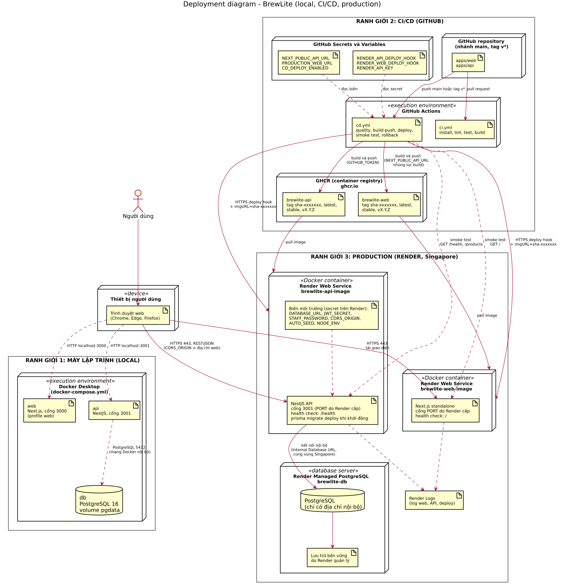
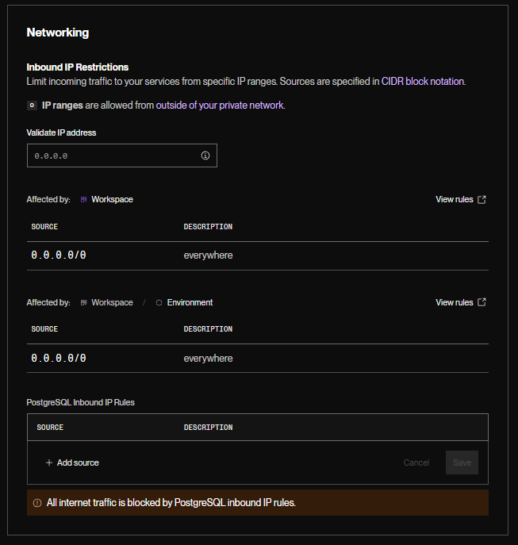

# Sơ đồ triển khai (Deployment diagram) – BrewLite

> Task 3 · Người thực hiện: Nguyễn Phạm Thái Tú · Reviewer: Quách Văn Trường
> Nguồn: [`deployment.puml`](deployment.puml) · Kết xuất: [`deployment.svg`](deployment.svg), [`deployment.png`](deployment.png)
> Thay thế hai sơ đồ cũ [`deployment-render.png`](deployment-render.png) và [`deploymentdiagram.png`](deploymentdiagram.png) (còn ghi PWA, CDN và GHCR "đề xuất").

## 1. Ba ranh giới

| Ranh giới | Chạy ở đâu | Cách khởi động | Mục đích |
|---|---|---|---|
| 1. Máy lập trình (local) | Docker Desktop | `docker compose up --build db api` (thêm `web` bằng profile `web`) | Phát triển và chạy thử. Cơ sở dữ liệu là container `db` với volume `pgdata`, **không phải** cơ sở dữ liệu production |
| 2. CI/CD (GitHub) | GitHub Actions | `ci.yml` khi mở Pull Request. `cd.yml` khi đẩy vào `main` hoặc gắn tag `v*` | Kiểm tra, build ảnh Docker, đẩy lên GHCR, ra lệnh deploy |
| 3. Production (Render, Singapore) | Render | Do `cd.yml` gọi deploy hook kèm tag ảnh | Chạy web, API và cơ sở dữ liệu cho người dùng thật |

## 2. Các node và container

| Node | Loại | Cổng | Vai trò |
|---|---|---|---|
| Trình duyệt web | Thiết bị người dùng | 443 (HTTPS) | Mở giao diện, gọi thẳng API |
| `brewlite-web-image` | Render Web Service, container Docker | `PORT` do Render cấp | Phục vụ giao diện Next.js (chế độ standalone) |
| `brewlite-api-image` | Render Web Service, container Docker | `PORT` do Render cấp (mặc định 3001) | API NestJS. Khi khởi động chạy `prisma migrate deploy` rồi mới nhận yêu cầu |
| `brewlite-db` | Render Managed PostgreSQL | 5432, chỉ địa chỉ nội bộ | Lưu dữ liệu quan hệ, lưu trữ bền vững do Render quản lý |
| GHCR (`ghcr.io`) | Registry ảnh Docker | 443 | Lưu ảnh `brewlite-api` và `brewlite-web` |
| GitHub Actions | Môi trường chạy pipeline | không | Chạy `ci.yml` và `cd.yml` |

## 3. Kết nối và giao thức

| Từ | Tới | Giao thức, cổng | Ghi chú bảo mật |
|---|---|---|---|
| Trình duyệt | Web (Render) | HTTPS 443 | Chứng chỉ do Render cấp |
| Trình duyệt | API (Render) | HTTPS 443, REST/JSON | Trình duyệt gọi **thẳng** API qua `NEXT_PUBLIC_API_URL`. API chỉ chấp nhận origin khớp `CORS_ORIGIN` |
| API | PostgreSQL (Render) | PostgreSQL 5432, mạng nội bộ cùng vùng | Dùng Internal Database URL, cơ sở dữ liệu không dùng địa chỉ công khai cho API |
| GitHub Actions | GHCR | HTTPS 443 | Đăng nhập bằng `GITHUB_TOKEN`, quyền `packages: write` |
| GHCR | Render | HTTPS 443, kéo ảnh | Ảnh công khai, không chứa bí mật |
| GitHub Actions | Render | HTTPS, deploy hook kèm `imgURL` | Deploy hook và khóa API lưu trong GitHub Secrets |
| GitHub Actions | Render (production) | HTTPS, smoke test | `GET /health`, `GET /products`, `GET /` |

## 4. Secret, biến môi trường, health check, log

| Hạng mục | Nơi cấu hình | Giá trị và ghi chú |
|---|---|---|
| Secret của pipeline | GitHub, Settings, Secrets and variables, Actions, Secrets | `RENDER_API_DEPLOY_HOOK`, `RENDER_WEB_DEPLOY_HOOK`, `RENDER_API_KEY`. Không có trong repo, GitHub tự che trong log |
| Biến của pipeline | GitHub, Variables | `NEXT_PUBLIC_API_URL`, `PRODUCTION_WEB_URL`, `CD_DEPLOY_ENABLED` |
| Biến môi trường của API | Render, `brewlite-api-image`, Environment | `DATABASE_URL`, `JWT_SECRET`, `STAFF_PASSWORD`, `CORS_ORIGIN`, `AUTO_SEED`, `NODE_ENV` |
| Biến lúc build của web | Build argument của `apps/web/Dockerfile` | `NEXT_PUBLIC_API_URL` được nhúng vào ảnh lúc build, nên đổi địa chỉ API phải build lại ảnh web |
| Health check API | Render, ô Health Check Path | `/health`. Trả `{"status":"ok","db":"up"}` khi API và cơ sở dữ liệu khỏe |
| Health check web | Render | `/` |
| Log | Render, mục Logs của từng dịch vụ. GitHub, tab Actions | Log ứng dụng, log deploy và log pipeline |
| Migration | Lúc khởi động API (`npm run start:prod`) | `prisma migrate deploy` chỉ áp dụng migration chưa chạy, không xóa dữ liệu |

## 5. Truy vết: container, mô tả kiến trúc, mã nguồn

| Container hoặc node | Mô tả kiến trúc | Mã nguồn và cấu hình | Nơi chạy |
|---|---|---|---|
| Web (Next.js) | [`frontend.md`](../architecture/frontend.md), [`010-architecture-overview.md`](../architecture/adr/010-architecture-overview.md) mục 2 đến 4, [`009-web-mobile-first-without-pwa.md`](../architecture/adr/009-web-mobile-first-without-pwa.md) | `apps/web/src/`, `apps/web/next.config.ts`, `apps/web/Dockerfile` | Local: service `web` trong `docker-compose.yml`. Production: `brewlite-web-image`, ảnh `ghcr.io/nguyenphamthaitu/brewlite-web` |
| API (NestJS) | [`010-architecture-overview.md`](../architecture/adr/010-architecture-overview.md), [`004-jwt-authentication.md`](../architecture/adr/004-jwt-authentication.md), [`005-payment-gateway-idempotency.md`](../architecture/adr/005-payment-gateway-idempotency.md), [`006-inventory-transaction-row-locking.md`](../architecture/adr/006-inventory-transaction-row-locking.md), [`008-simulated-wallet-card-payment.md`](../architecture/adr/008-simulated-wallet-card-payment.md), [`010-config-health-logging.md`](../architecture/adr/010-config-health-logging.md) | `apps/api/src/` (đặc biệt `main.ts`, `health/health.controller.ts`), `apps/api/Dockerfile`, `apps/api/package.json` (script `start:prod`) | Local: service `api`. Production: `brewlite-api-image`, ảnh `ghcr.io/nguyenphamthaitu/brewlite-api` |
| PostgreSQL | [`003-postgresql-prisma-migrations.md`](../architecture/adr/003-postgresql-prisma-migrations.md) | `apps/api/prisma/schema.prisma`, `apps/api/prisma/migrations/`, `apps/api/src/prisma/prisma.service.ts` | Local: service `db` và volume `pgdata`. Production: Render Managed PostgreSQL `brewlite-db` |
| GitHub Actions CI | [`007-ci-cd-github-actions.md`](../architecture/adr/007-ci-cd-github-actions.md) | `.github/workflows/ci.yml` | GitHub |
| GitHub Actions CD | [`007-ci-cd-github-actions.md`](../architecture/adr/007-ci-cd-github-actions.md) | `.github/workflows/cd.yml` | GitHub |
| GHCR | [`007-ci-cd-github-actions.md`](../architecture/adr/007-ci-cd-github-actions.md) | Job `build-push` trong `.github/workflows/cd.yml` | `ghcr.io/nguyenphamthaitu/brewlite-api`, `brewlite-web` |
| Render | [`002-deploy-platform.md`](../architecture/adr/002-deploy-platform.md), [`009-adr-render-deployment.md`](../architecture/adr/009-adr-render-deployment.md) | Cấu hình trên Render Dashboard (không lưu trong repo). Liên kết với pipeline qua deploy hook trong GitHub Secrets | Render, vùng Singapore |

## 6. Đối chiếu với thực tế

- [x] API trả `{"status":"ok","db":"up"}` ở `/health` (log smoke test của `cd.yml`).
- [x] API kết nối cơ sở dữ liệu bằng địa chỉ nội bộ (log khởi động API ghi tên máy `dpg-...-a` không có tên miền công khai).
- [x] Migration chạy lúc khởi động (log ghi `No pending migrations to apply`).
- [x] Pipeline đẩy ảnh gắn tag `sha-xxxxxxx`, `latest`, `stable` và tag phiên bản lên GHCR.
- [x] Đã xóa quy tắc 0.0.0.0/0 trong PostgreSQL Inbound IP Rules
- 
- [x] Cơ sở dữ liệu Render không cho kết nối từ internet: đã xóa quy tắc `0.0.0.0/0` trong PostgreSQL Inbound IP Rules, API vẫn kết nối bằng địa chỉ nội bộ.
- [ ] Đã xác nhận chính sách sao lưu của gói cơ sở dữ liệu miễn phí.
- [ ] Đã chạy thử quay lui (bằng chứng trong `docs/deployment.md`).

## 7. Hạn chế đã biết

- Dịch vụ Render gói miễn phí "ngủ" khi không có truy cập, lần mở đầu chờ khoảng 50 giây.
- Cơ sở dữ liệu gói miễn phí của Render có thời hạn.
- Quay lui đưa dịch vụ về ảnh `stable`, nhưng migration của Prisma chỉ tiến lên, không tự hoàn tác. Migration mới phải tương thích ngược.