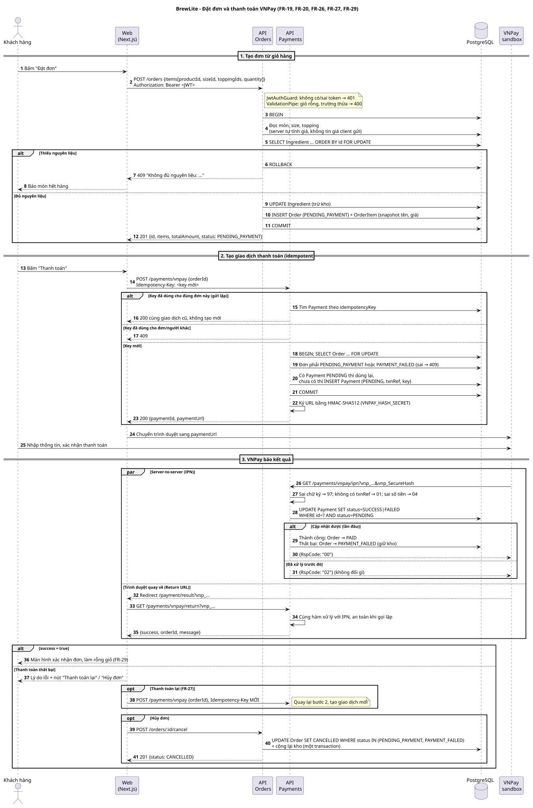
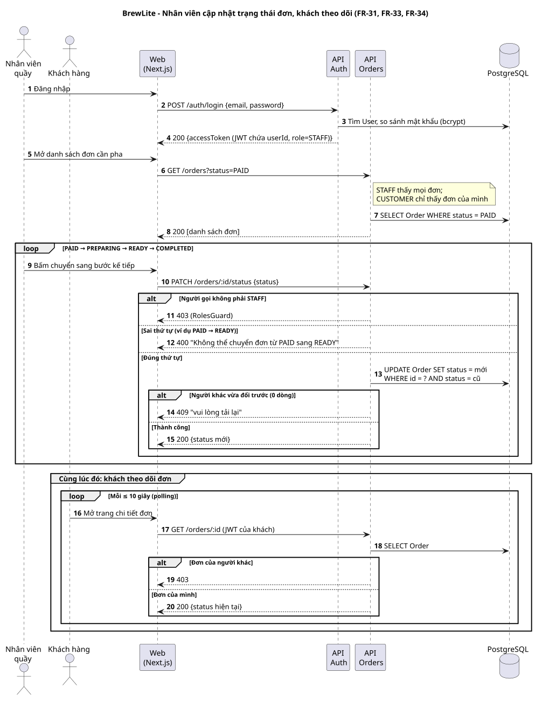

# Sequence diagram – BrewLite

Hai sơ đồ tuần tự cho hai luồng chính của MVP. Nguồn PlantUML (`.puml`) để sửa, ảnh `.svg` để xem.
Các bước trong sơ đồ bám theo code API hiện tại (`apps/api/src/orders`, `apps/api/src/payments`)
và các FR trong [SRS](../requirements/srs.md).

## 1. Đặt đơn và thanh toán VNPay



Nguồn: [`sequence-order-payment.puml`](sequence-order-payment.puml)

| Giai đoạn | Điểm chính | FR / ADR |
|---|---|---|
| Tạo đơn | Server tự tính giá; khóa dòng `Ingredient` theo thứ tự id rồi mới kiểm tra và trừ kho; thiếu kho thì rollback toàn bộ, trả 409 | FR-19, FR-20, FR-21, ADR-006 |
| Tạo giao dịch | Bắt buộc header `Idempotency-Key`; gửi lặp cùng key trả lại đúng giao dịch cũ; khóa dòng `Order` để hai request đồng thời không tạo hai giao dịch | FR-26, ADR-005 |
| Nhận kết quả | IPN (VNPay gọi server) và Return URL (trình duyệt quay về) dùng chung một hàm xử lý; `UPDATE ... WHERE status = PENDING` nên gọi lặp không xử lý hai lần (mã `02`) | FR-26, ADR-005 |
| Thất bại | Đơn chuyển `PAYMENT_FAILED`, giữ nguyên kho; khách thanh toán lại bằng key mới hoặc hủy đơn để hoàn kho | FR-27 |
| Thành công | Đơn chuyển `PAID`, web hiển thị xác nhận và làm rỗng giỏ | FR-29 |

## 2. Nhân viên cập nhật trạng thái, khách theo dõi đơn



Nguồn: [`sequence-staff-status.puml`](sequence-staff-status.puml)

| Điểm chính | FR |
|---|---|
| Chỉ role `STAFF` được đổi trạng thái (`RolesGuard`), khách gọi nhận 403 | FR-17, FR-34 |
| Chỉ đi đúng thứ tự `PAID → PREPARING → READY → COMPLETED`; nhảy bước trả 400 | FR-34 |
| `UPDATE ... WHERE status = <trạng thái cũ>`: hai nhân viên bấm cùng lúc thì người sau nhận 409, không ghi đè | FR-34 |
| Nhân viên lọc đơn bằng `GET /orders?status=PAID` | FR-33 |
| Khách tự tải lại trạng thái bằng `GET /orders/:id` tối đa 10 giây/lần; xem đơn người khác bị 403 | FR-17, FR-31 |

## Ghi chú

- Phía Web trong sơ đồ là luồng theo thiết kế (SRS). Trang đặt đơn, thanh toán và màn hình quầy
  của frontend chưa nối API ở thời điểm viết tài liệu.
- Luồng thanh toán vẽ theo hành vi trong PR #16 (`Idempotency-Key`, trạng thái `PAYMENT_FAILED`,
  thanh toán lại).
- SRS ghi đường dẫn nhân viên là `GET /staff/orders`; code hiện dùng `GET /orders?status=` với role
  `STAFF`. Cần thống nhất một trong hai.

## Cập nhật ảnh

```bash
java -jar plantuml.jar -charset UTF-8 -tsvg docs/diagrams/sequence-*.puml
```
