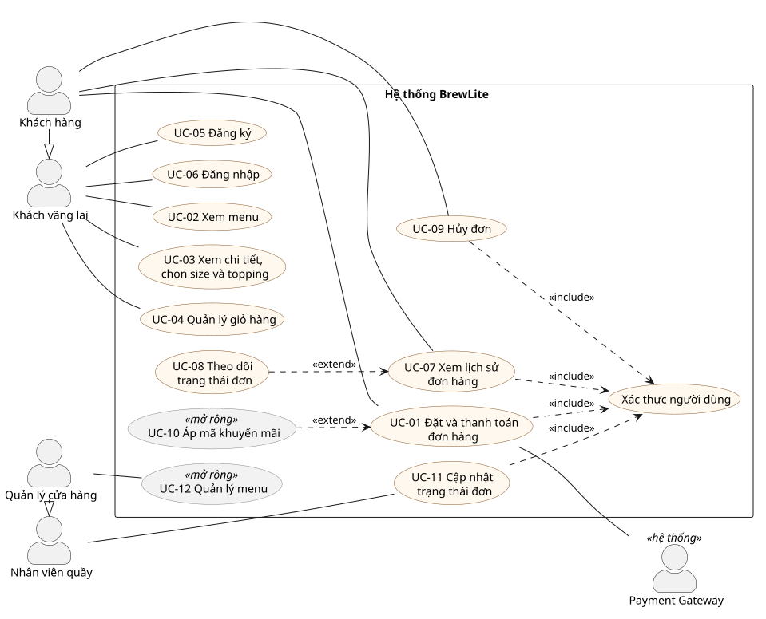

# Sơ đồ use-case tổng quát – BrewLite

> Task 1.2, mục 5 · Người thực hiện: Quách Văn Trường · Reviewer: Quách Anh Vũ
> Nguồn sơ đồ: [`docs/diagrams/usecase-overview.puml`](../diagrams/usecase-overview.puml)

## 0. Tài liệu làm căn cứ

| Tài liệu | Người viết | Trạng thái (11/11) | Dùng cho |
|----------|-----------|--------------------|----------|
| [`scope-assumptions-risks.md`](scope-assumptions-risks.md) | Thái Tú | Đã merge (PR #7) | Phạm vi MVP / mở rộng, chỉ làm web, thanh toán mô phỏng Ví/Thẻ |
| [`context-and-scope.md`](context-and-scope.md) | Anh Vũ | Đã merge (PR #10, #11) | Danh sách stakeholder → tác nhân |
| [`use-case-order-payment.md`](use-case-order-payment.md) | Anh Vũ | Đã merge (PR #10) | UC-01 và tác nhân Payment Gateway |
| [`srs.md`](srs.md) (FR-01 → FR-43, UC-01 → UC-07) | Minh Trí, Hữu Mẫn; Tuấn Vỹ gộp và đánh số lại | Đã merge (PR #1, PR #15) | Mã FR ở cột *Yêu cầu liên quan*, tác nhân, vòng đời đơn |

## 1. Tác nhân

| Tác nhân | Loại | Mô tả | Stakeholder tương ứng (context-and-scope) |
|----------|------|-------|-------------------------------------------|
| Khách vãng lai | Chính | Chưa đăng nhập: xem menu, xem chi tiết, chọn size/topping, dùng giỏ hàng, đăng ký, đăng nhập. | Khách hàng |
| Khách hàng (đã đăng nhập) | Chính | Kế thừa khách vãng lai; đặt đơn, thanh toán, xem lịch sử, theo dõi và hủy đơn. | Khách hàng |
| Nhân viên quầy | Chính | Cập nhật trạng thái đơn đã thanh toán (pha chế, sẵn sàng, hoàn tất). | Nhân viên thu ngân, Nhân viên pha chế |
| Quản lý cửa hàng | Chính | Kế thừa nhân viên quầy; quản lý menu (mở rộng). | Quản lý cửa hàng |
| Payment Gateway (mô phỏng Ví/Thẻ) | Phụ (hệ thống) | Nhận yêu cầu thanh toán, trả kết quả thành công hoặc thất bại. | Đơn vị thanh toán |

Quản trị viên hệ thống, nhóm phát triển và giảng viên nghiệm thu là stakeholder nhưng không thao tác
chức năng nghiệp vụ nên không phải tác nhân trên sơ đồ.

## 2. Danh sách use-case

| Mã | Use-case | Tác nhân | Phạm vi | Yêu cầu liên quan (`srs.md`) | Nhóm UC trong SRS |
|----|----------|----------|---------|------------------------------|-------------------|
| UC-01 | Đặt và thanh toán đơn hàng | Khách hàng, Payment Gateway | MVP | FR-18 → FR-21, FR-24 → FR-27, FR-29 | UC-04 |
| UC-02 | Xem menu | Khách vãng lai | MVP | FR-01 → FR-05 | UC-01 |
| UC-03 | Xem chi tiết, chọn size và topping | Khách vãng lai | MVP | FR-06 → FR-09 | UC-01 |
| UC-04 | Quản lý giỏ hàng | Khách vãng lai | MVP | FR-10 → FR-13 | UC-02 |
| UC-05 | Đăng ký | Khách vãng lai | MVP | FR-14 | UC-03 |
| UC-06 | Đăng nhập | Khách vãng lai | MVP | FR-15, FR-16 | UC-03 |
| UC-07 | Xem lịch sử và chi tiết đơn | Khách hàng | MVP | FR-30 | UC-05 |
| UC-08 | Theo dõi trạng thái đơn (tải lại trang hoặc polling) | Khách hàng | MVP | FR-31, FR-32 | UC-05 |
| UC-09 | Hủy đơn khi chưa thanh toán xong | Khách hàng | MVP | FR-22, FR-27; vòng đời đơn (SRS mục 2.2) | UC-04 |
| UC-10 | Áp mã khuyến mãi | Khách hàng | Mở rộng | FR-36 | UC-07 |
| UC-11 | Cập nhật trạng thái đơn | Nhân viên quầy | MVP | FR-33, FR-34 | UC-06 |
| UC-12 | Quản lý menu | Quản lý cửa hàng | Mở rộng | FR-35 | UC-07 |

Căn cứ phạm vi: tài liệu phạm vi xếp "Nhân viên/quản lý cập nhật trạng thái đơn" vào MVP; "Khuyến mãi"
và "Quản lý menu cho quản lý cửa hàng" vào phạm vi mở rộng; SRS xếp FR-35 mức Should, FR-36 mức Could.
Căn cứ khách vãng lai: SRS mục 2.1 ghi khách vãng lai xem menu, chi tiết sản phẩm, thêm vào giỏ khi
chưa đăng nhập; FR-18 yêu cầu đăng nhập khi đặt đơn.

UC-01 khớp mã và tên với đặc tả chi tiết của Anh Vũ ([`use-case-order-payment.md`](use-case-order-payment.md)) và với mẫu ma trận truy vết của đề
(`UC-01 Thanh toán`).

## 3. Quan hệ giữa các use-case

| Quan hệ | Ý nghĩa | Căn cứ |
|---------|---------|--------|
| UC-01, UC-07, UC-09, UC-11 `<<include>>` Xác thực JWT | Bắt buộc đã đăng nhập; chưa đăng nhập thì chuyển sang UC-06. | FR-17, FR-18 |
| UC-08 `<<extend>>` UC-07 | Từ lịch sử/chi tiết đơn, khách xem trạng thái hiện tại. | FR-30, FR-31 |
| UC-10 `<<extend>>` UC-01 | Nhập mã khuyến mãi khi đặt đơn, không bắt buộc. | FR-36, tài liệu phạm vi (mở rộng) |
| Khách hàng kế thừa Khách vãng lai | Mọi use-case của khách vãng lai đều dùng được khi đã đăng nhập. | |
| Quản lý cửa hàng kế thừa Nhân viên quầy | Quản lý làm được mọi việc của nhân viên quầy. | FR-17: vai trò CUSTOMER, STAFF, ADMIN |

## 4. Ghi chú đối chiếu với SRS

1. **Mã UC khác nhau giữa hai tài liệu.** Sơ đồ này giữ mã UC-01 → UC-12 (UC-01 trùng với đặc tả chi
   tiết của Anh Vũ). SRS gom thành 7 nhóm UC-01 → UC-07; cột *Nhóm UC trong SRS* ở mục 2 cho biết
   mỗi use-case thuộc nhóm nào.
2. **Báo cáo doanh thu (FR-38, Could)** của Quản lý/Admin chưa vẽ trên sơ đồ vì nằm ngoài MVP và
   chưa có trong tài liệu phạm vi.
