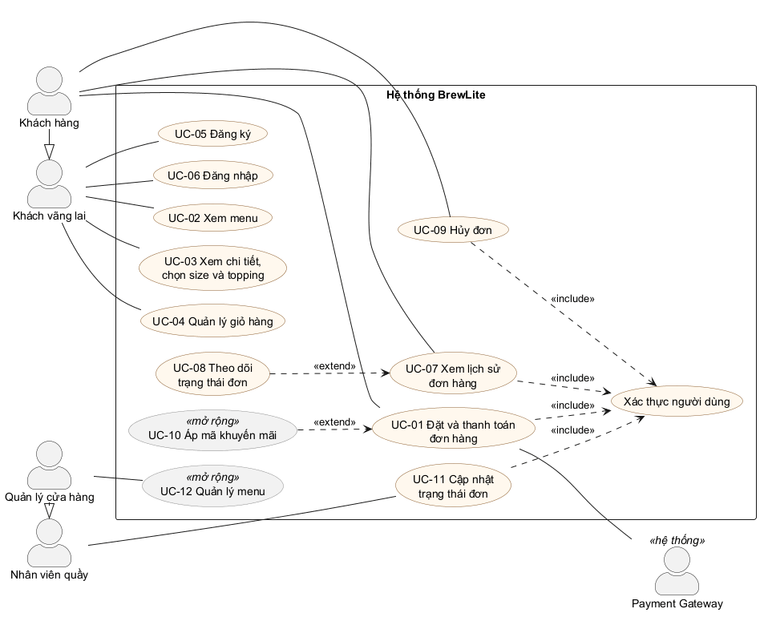

# Sơ đồ use-case tổng quát – BrewLite

> Task 1.2, mục 5 · Người thực hiện: Quách Văn Trường · Reviewer: Quách Anh Vũ
> Nguồn sơ đồ: [`docs/diagrams/usecase-overview.puml`](../diagrams/usecase-overview.puml) · Ảnh: [PNG](../diagrams/usecase-overview.png), [SVG](../diagrams/usecase-overview.svg)

## 0. Tài liệu làm căn cứ

| Tài liệu | Người viết | Dùng cho |
|----------|-----------|----------|
| [`srs.md`](srs.md) | Tuấn Vỹ, Minh Trí | Mã yêu cầu FR, mức ưu tiên MoSCoW |
| [`scope-assumptions-risks.md`](scope-assumptions-risks.md) | Thái Tú | Phạm vi MVP / mở rộng, chỉ làm web |
| [`context-and-scope.md`](context-and-scope.md) | Anh Vũ | Danh sách stakeholder → tác nhân |
| [`use-case-order-payment.md`](use-case-order-payment.md) | Anh Vũ | Đặc tả UC-01 và tác nhân Payment Gateway |

## 1. Tác nhân

| Tác nhân | Loại | Mô tả | Stakeholder tương ứng |
|----------|------|-------|-----------------------|
| Khách vãng lai | Chính | Chưa đăng nhập: xem menu, xem chi tiết, chọn size/topping, dùng giỏ hàng, đăng ký, đăng nhập. | Khách hàng |
| Khách hàng (đã đăng nhập) | Chính | Kế thừa khách vãng lai; đặt đơn, thanh toán, xem lịch sử, theo dõi và hủy đơn. | Khách hàng |
| Nhân viên quầy | Chính | Xem và cập nhật trạng thái đơn đã thanh toán (pha chế, sẵn sàng, hoàn tất). | Nhân viên thu ngân, Nhân viên pha chế |
| Quản lý cửa hàng | Chính | Kế thừa nhân viên quầy; quản lý menu (mở rộng). | Quản lý cửa hàng |
| Payment Gateway | Phụ (hệ thống) | Nhận yêu cầu thanh toán Ví/Thẻ, trả kết quả thành công hoặc thất bại. | Đơn vị thanh toán |

Quản trị viên hệ thống, nhóm phát triển và giảng viên nghiệm thu là stakeholder nhưng không thao tác
chức năng nghiệp vụ nên không phải tác nhân trên sơ đồ.

## 2. Danh sách use-case

| Mã | Use-case | Tác nhân | Phạm vi | Yêu cầu liên quan (`srs.md`) |
|----|----------|----------|---------|------------------------------|
| UC-01 | Đặt và thanh toán đơn hàng | Khách hàng, Payment Gateway | MVP | FR-18 → FR-22, FR-24 → FR-27, FR-29 |
| UC-02 | Xem menu | Khách vãng lai | MVP | FR-01 → FR-05 |
| UC-03 | Xem chi tiết, chọn size và topping | Khách vãng lai | MVP | FR-06 → FR-09 |
| UC-04 | Quản lý giỏ hàng | Khách vãng lai | MVP | FR-10 → FR-13 |
| UC-05 | Đăng ký | Khách vãng lai | MVP | FR-14 |
| UC-06 | Đăng nhập, đăng xuất | Khách vãng lai | MVP | FR-15, FR-16 |
| UC-07 | Xem lịch sử và chi tiết đơn | Khách hàng | MVP | FR-30 |
| UC-08 | Theo dõi trạng thái đơn | Khách hàng | MVP | FR-31 (FR-32: Could) |
| UC-09 | Hủy đơn chưa thanh toán | Khách hàng | MVP | Mục 2.2 (vòng đời đơn), FR-22 |
| UC-10 | Áp mã khuyến mãi | Khách hàng | Mở rộng | FR-36 (Could) |
| UC-11 | Cập nhật trạng thái đơn | Nhân viên quầy | MVP | FR-33, FR-34 |
| UC-12 | Quản lý menu | Quản lý cửa hàng | Mở rộng | FR-35 (Should) |

Căn cứ phạm vi: tài liệu phạm vi xếp "Nhân viên/quản lý cập nhật trạng thái đơn" vào MVP; "Khuyến mãi"
và "Quản lý menu cho quản lý cửa hàng" vào phạm vi mở rộng. Căn cứ khách vãng lai: mục 2.1 của SRS
(khách vãng lai xem menu, chi tiết sản phẩm, thêm vào giỏ khi chưa đăng nhập) và FR-18 (chỉ yêu cầu đăng
nhập khi đặt đơn).

UC-01 khớp mã và tên với đặc tả chi tiết của Anh Vũ ([`use-case-order-payment.md`](use-case-order-payment.md))
và với mẫu ma trận truy vết của đề (`UC-01 Thanh toán`).

## 3. Quan hệ giữa các use-case

| Quan hệ | Ý nghĩa | Căn cứ |
|---------|---------|--------|
| UC-01, UC-07, UC-09, UC-11 `<<include>>` Xác thực người dùng | Bắt buộc đã đăng nhập (JWT); chưa đăng nhập thì chuyển sang UC-06. | FR-17, FR-18 |
| UC-08 `<<extend>>` UC-07 | Từ lịch sử/chi tiết đơn, khách xem trạng thái hiện tại. | FR-30, FR-31 |
| UC-10 `<<extend>>` UC-01 | Nhập mã khuyến mãi khi đặt đơn, không bắt buộc. | FR-36 |
| Khách hàng kế thừa Khách vãng lai | Mọi use-case của khách vãng lai đều dùng được khi đã đăng nhập. | Mục 2.1 SRS |
| Quản lý cửa hàng kế thừa Nhân viên quầy | Quản lý làm được mọi việc của nhân viên quầy. | FR-17 (phân quyền theo vai trò) |

## 4. Ghi chú

- Mục 7 của `srs.md` đánh số use-case theo nhóm chức năng (UC-01 = Xem menu). Sơ đồ này giữ
  **UC-01 = Đặt và thanh toán đơn hàng** để khớp với đặc tả chi tiết đã merge và mẫu ma trận truy vết
  của đề. Đề nghị cập nhật mục 7 của SRS theo bảng ở mục 2.
- Khách hủy đơn (UC-09) chưa có mã FR riêng trong SRS; đang căn cứ vòng đời đơn ở mục 2.2 và FR-22.
